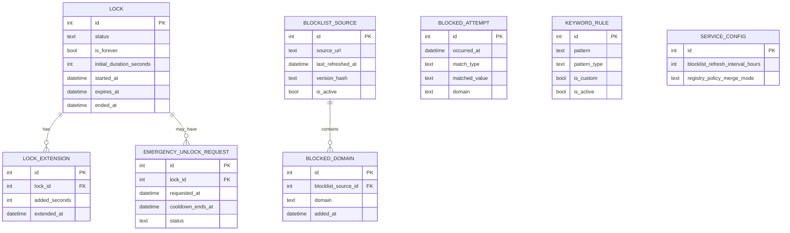

# Warden — Entity Relationship Document

## 1. Storage Decisions

- **Engine**: SQLite (via the `rusqlite` crate), embedded directly in the Rust Windows service.
- **Location**: a machine-wide path such as `%ProgramData%\Warden\warden.db`, not the user's profile — `ProgramData` is writable only by admin/SYSTEM by default, which matters for tamper resistance (a standard user shouldn't be able to open the file and hand-edit lock state).
- **Source of truth**: the service owns this database exclusively. The extension never writes to it directly — it only reads via Native Messaging requests/responses. This keeps the tamper-resistance guarantee intact: nothing reachable from inside the browser sandbox can alter lock state.
- **Attempt/log retention**: kept indefinitely by default in v1 (personal-use data volume is small); a retention setting can be added later if the log grows large.
- **Derived stats**: daily counts and streaks are computed with a query over `blocked_attempt` at read time rather than stored in a separate materialized table — data volume for a single-user tool doesn't justify the extra write complexity and sync risk of keeping a duplicate table in lockstep.

## 2. Entities

### `lock`
The current and historical lock periods. One row per lock the user has ever started.

| Column | Type | Notes |
|---|---|---|
| `id` | INTEGER PK | |
| `status` | TEXT | `active` \| `expired` \| `forever` |
| `is_forever` | BOOLEAN | true if "lock forever" was selected |
| `initial_duration_seconds` | INTEGER, nullable | null when `is_forever` is true |
| `started_at` | DATETIME | |
| `expires_at` | DATETIME, nullable | null when `is_forever` is true; recalculated on extension |
| `ended_at` | DATETIME, nullable | set when a lock naturally expires |
| `created_at` | DATETIME | |

Only one `lock` row should be `active` or `forever` at a time — enforced in service logic, not a DB constraint (SQLite has no partial-unique-index-with-app-logic guarantee worth relying on here, easier to check in code before insert).

### `lock_extension`
Every time the user adds time to an active lock. Append-only audit trail — extending is always allowed, so this table exists purely for transparency in the dashboard, not for permission logic.

| Column | Type | Notes |
|---|---|---|
| `id` | INTEGER PK | |
| `lock_id` | INTEGER FK → `lock.id` | |
| `added_seconds` | INTEGER | |
| `extended_at` | DATETIME | |

### `emergency_unlock_request`
Tracks requests to end a "lock forever" state early, including the mandatory cooldown.

| Column | Type | Notes |
|---|---|---|
| `id` | INTEGER PK | |
| `lock_id` | INTEGER FK → `lock.id` | must reference a `forever` lock |
| `requested_at` | DATETIME | |
| `cooldown_ends_at` | DATETIME | `requested_at` + 7 days (default, not user-configurable while pending) |
| `status` | TEXT | `pending` \| `cancelled` \| `applied` |
| `cancelled_at` | DATETIME, nullable | |
| `applied_at` | DATETIME, nullable | |

### `blocked_attempt`
Log of every navigation the blocking engine stopped. Independent of `lock` — blocking itself is always active regardless of lock/timer state; the lock only governs whether blocking *can be turned off*.

| Column | Type | Notes |
|---|---|---|
| `id` | INTEGER PK | |
| `occurred_at` | DATETIME | |
| `match_type` | TEXT | `blocklist` \| `keyword` |
| `matched_value` | TEXT | the domain or keyword/pattern that triggered the block |
| `domain` | TEXT | the domain of the blocked navigation (stored separately from full URL — no path/query retained, by design, per PRD §7.5 privacy note) |

No foreign key to `blocklist_domain` or `keyword_rule` — blocklists get refreshed and rows removed/replaced over time, so a strict FK would break historical log entries. Storing the matched value as plain text keeps the log accurate regardless of later blocklist changes.

### `blocklist_source`
Metadata about the maintained domain blocklist and its refresh state.

| Column | Type | Notes |
|---|---|---|
| `id` | INTEGER PK | |
| `source_url` | TEXT | |
| `last_refreshed_at` | DATETIME, nullable | |
| `version_hash` | TEXT, nullable | hash of the fetched list, used to detect whether a refresh actually changed anything |
| `is_active` | BOOLEAN | allows disabling a source without deleting history |

### `blocked_domain`
The actual domain entries currently in effect.

| Column | Type | Notes |
|---|---|---|
| `id` | INTEGER PK | |
| `blocklist_source_id` | INTEGER FK → `blocklist_source.id` | |
| `domain` | TEXT | indexed for fast lookup |
| `added_at` | DATETIME | |

### `keyword_rule`
URL keyword/pattern rules, separate from the domain blocklist since these are usually curated locally rather than fetched.

| Column | Type | Notes |
|---|---|---|
| `id` | INTEGER PK | |
| `pattern` | TEXT | |
| `pattern_type` | TEXT | `keyword` \| `regex` |
| `is_custom` | BOOLEAN | distinguishes user-added rules from the bundled default set |
| `is_active` | BOOLEAN | |
| `created_at` | DATETIME | |

### `service_config`
Single-row table for service-wide settings.

| Column | Type | Notes |
|---|---|---|
| `id` | INTEGER PK | always `1` — enforced as a singleton in application code |
| `blocklist_refresh_interval_hours` | INTEGER | default 24 |
| `registry_policy_merge_mode` | TEXT | `overwrite` \| `merge` — how to handle pre-existing `ExtensionSettings` policy (see PRD §11 risk) |
| `updated_at` | DATETIME | |

## 3. Relationships

```
lock (1) ──── (many) lock_extension
lock (1) ──── (many) emergency_unlock_request   [only for is_forever = true]

blocklist_source (1) ──── (many) blocked_domain

blocked_attempt   — no FK relationships (matched_value stored as text, see above)
keyword_rule      — standalone, no relationships
service_config    — standalone singleton
```



## 4. Open Questions for the Staged Build Plan

- Should `blocked_domain` support bulk insert/replace on refresh (wipe-and-reload per source) rather than diffing row by row? Simpler and fine at this data volume — worth confirming before build so the refresh routine is designed around it from the start.
- Does the dashboard need pagination on `blocked_attempt` from day one, or is a simple "last 30 days" default view sufficient for v1?
- Should `emergency_unlock_request` be restricted to one pending request at a time via application logic (recommended) to avoid ambiguous cooldown states?
